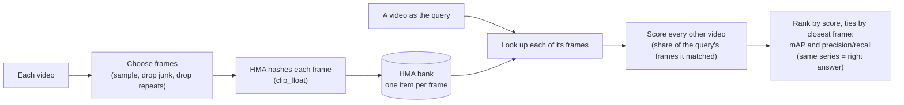

# Video evaluation

Video is evaluated as a bag of frames: representative frames are chosen from each video,
hashed with the existing CLIP image signal, and stored in HMA. Two frames match when their cosine
distance is at most a *frame distance* (0.10 by default). A video's score against another is the
fraction of its frames that found a match in the other, and the other videos are ranked by that score.
[docs/EVALUATION_DESCRIPTION.md](docs/EVALUATION_DESCRIPTION.md) has the details, including how the
frame distance is chosen.

Where these docs refer to "the series dataset" they mean UMass Rescue Lab's
[video-series-dataset](https://github.com/UMass-Rescue/video-series-dataset): 398 clips of
3 seconds each (18 frames at 6 fps), cut from the first 100 videos of subset 51 of Meta's
SA-V dataset and grouped into 100 series, each series being the consecutive segments of one
source video.

## How it works



## Quick start

Start HMA first (the root [README.md](../../README.md)'s Quick Start). Each run **resets HMA's
database**, as the image evaluation does, so it replaces whatever other evaluations left in it.
HMA is reached over plain HTTP and receives the frames as images, so keep it on localhost or the
Docker network.

```bash
make video-smoke-test         # about 1 minute, no dataset needed: see "Smoke test" below
make fetch-video-dataset      # once: the series dataset, about 550 MB, at a pinned commit
make run-video-evaluation     # the full evaluation, about 4 minutes on the series dataset
```

The same in Docker, which already sees the repo (and so the dataset) at `/build`:

```bash
docker compose run --rm evaluation python hma/video/smoke_test.py
docker compose run --rm evaluation python hma/video/evaluate.py
```

Results are written to `results/evaluation_results/<timestamp>/` (`OUTPUT_DIR` changes the root)
and the log to `results/test_run_logs/`. To point the evaluation at another folder of series
folders, set `VIDEO_INPUT_DIR` to it (a series is a subfolder with at least two videos).

### Smoke test

[smoke_test.py](smoke_test.py) writes 12 generated clips ([sample_videos.py](sample_videos.py): four
series of three clips, the same files every time), runs the whole evaluation on them, and checks
that every result file exists and that the first hit of every query is right. It prints the
commands that reproduce it, and exits non-zero if a check fails. Expect
`✓ Video smoke test passed: 12 videos, 24 frames`. The generated clips are in
`results/video_smoke_samples/`, which can be deleted afterwards; to write them elsewhere run
`python -m hma.video.sample_videos <folder>`.

## Read more

- [docs/EVALUATION_DESCRIPTION.md](docs/EVALUATION_DESCRIPTION.md): what the three suites measure, the result
  files, the settings, and how frames are stored in HMA and scored.
- [docs/FRAME_SELECTION.md](docs/FRAME_SELECTION.md): how a video becomes the frames that are hashed, and the
  settings of each step.

## Dependencies

- `opencv-python-headless` is pinned below 4.13 in [requirements.txt](../../requirements.txt):
  PySceneDetect 0.7.3 crashes on OpenCV 4.14 and 5.0 (the video position is NaN at the end
  of the stream), and 4.12 works.
- PySceneDetect itself is installed with `--no-deps` from
  [requirements-scenedetect.txt](../../requirements-scenedetect.txt), because it declares the
  non-headless `opencv-python`, which needs GUI libraries the evaluation image does not have.
  The Dockerfile and `make create-env` both do this. pip then prints a warning that
  `scenedetect requires opencv-python, which is not installed`, which is expected.
- Licences: PySceneDetect is BSD-3-Clause and OpenCV is Apache-2.0, so both can ship in an open source
  project. The OpenCV wheels bundle FFmpeg under the LGPL (not the GPL), which a published Docker
  image may need a third-party notice for. The repository's own licence is tracked in
  [#48](https://github.com/UMass-Rescue/2025-project-roost-evaluation/issues/48).

## Unit tests

The tests generate small synthetic videos on the fly, so they need no dataset:

```bash
pip install -r hma/requirements-dev.txt
PYTHONPATH=. python -m pytest hma/unit_tests/ -k video -v
```
